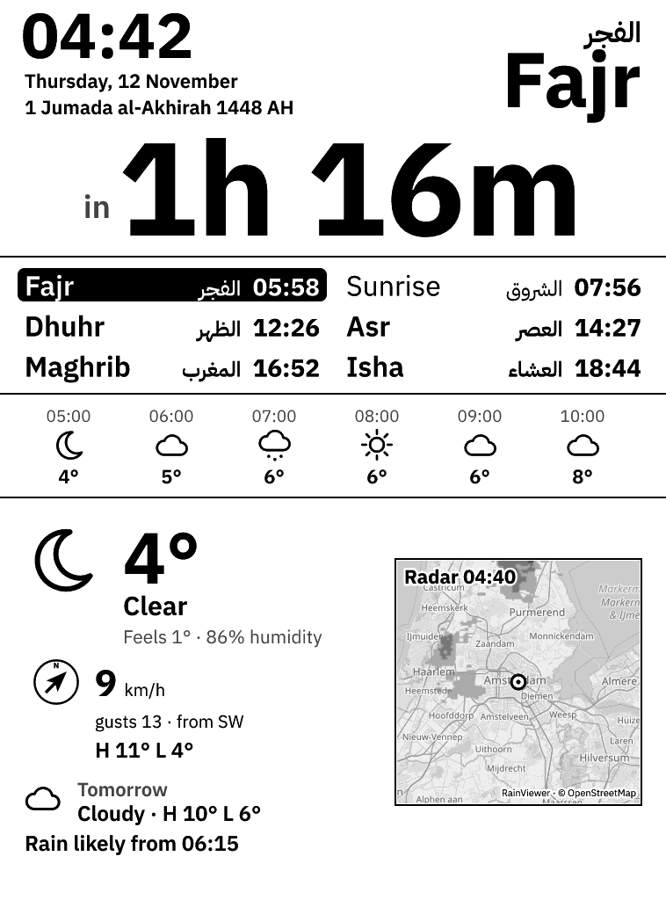

<p align="center">
  
</p>

<h1 align="center">kindil · قنديل</h1>

<p align="center">
  Turn a first-generation Kindle Paperwhite into a prayer-time wall
  dashboard and e-reader.
</p>

## Why

The 2012 Kindle Paperwhite has a lovely e-ink screen, a front light and Wi-Fi,
and Amazon no longer supports it. kindil gives it a second life as something
you hang on a wall: the next prayer and the time left until it, today's
prayer times, the weather and a rain radar, readable across a room, lit or
unlit, for days on one charge. It's also a simple reader for your own books.

kindil is one small program that takes over the Kindle while it runs. It
replaces Amazon's software for the screen, Wi-Fi, power and sleep, so
nothing of Amazon's store, sync or ads runs, and it never changes the
Kindle's system: exit kindil, or remove it, and the Kindle is stock again.

## What it does

<p align="center">
  
</p>

- **Prayer dashboard**: the next prayer and a countdown, today's six times in
  Arabic and English, the Hijri date, the weather, tomorrow's forecast, and a
  rain radar when rain is coming. Twelve calculation methods and both Asr
  schools, chosen in Settings.
- **Always on, low power**: after two minutes untouched the light goes off and
  the Kindle sleeps between updates, waking each minute to move the clock and
  every 30 minutes to fetch the weather.
- **Reader**: EPUB and text books from the Kindle's `books` folder, with your
  place, text size and light remembered.
- **Settings on the device**: location (search a city or use your approximate
  location), prayer method, Wi-Fi, light, sleep, start at boot.
- **Updates over Wi-Fi**: signed releases from this repository, tried first and
  rolled back automatically if they don't run well.
- **Safe by design**: if kindil crashes it restarts; if it keeps crashing the
  previous version runs; if that fails too, Amazon's own interface comes back.

## Install

You need:

1. A **first-generation Kindle Paperwhite** (2012). Its serial number
   (Settings → Device Info) starts with B024, B01B, B020, B01C, B01D or B01F.
   No other Kindle is supported.
2. A **jailbreak** and **KUAL**, done once on the Kindle. Amazon's software
   only runs programs Amazon signed; the jailbreak lets the Kindle run others.
   Follow the MobileRead community's guides:
   - Firmware up to 5.4.4.2: the
     [Touch/PW1/PW2 jailbreak](https://www.mobileread.com/forums/showthread.php?t=186645).
   - Firmware 5.6.1.1: [downgrade to 5.3.3](https://www.mobileread.com/forums/showthread.php?t=264432)
     first, then the jailbreak above. Read the threads through first: a
     firmware change can brick a Kindle.
   - Then [KUAL](https://www.mobileread.com/forums/showthread.php?t=203326),
     usually with [MRPI](https://www.mobileread.com/forums/showthread.php?t=251143).
3. A computer (macOS, Linux or Windows) with [Rust](https://rustup.rs), to run
   the installer. There are no prebuilt installer downloads yet.

Then:

```sh
git clone https://github.com/sharno/kindil && cd kindil
cargo run --release -p kindil-installer-gui
```

Plug the Kindle in with a USB cable and unlock it. The installer finds it,
checks it's a Paperwhite 1 with a jailbreak and KUAL (and says what's missing
if not), installs the latest signed release, and ejects it. Your settings are
kept, so the same button upgrades an existing install. (Prefer a terminal?
`cargo run --release -p kindil-installer -- install`.)

<p align="center">
  
</p>

On the Kindle, open **KUAL → kindil → Start kindil**, then set your place in
**Settings → Location**.

**Start at boot** (optional): to have the Kindle come up straight into kindil,
install the boot job once over SSH with
`sh /mnt/us/extensions/kindil/boot/install.sh install`, then choose a mode in
**Settings → Power → Start at boot**. It's the only system file kindil ever
adds, and if kindil doesn't stay up after a boot, the next boot returns to
Amazon's interface.

## Getting back to the stock Kindle

- **Settings → Power → Exit to Kindle** brings back Amazon's interface.
- Without start at boot, restarting the Kindle always returns it to stock.
- To remove kindil, delete the `extensions/kindil` and `kindil` folders from
  the Kindle over USB (and, if you installed it,
  `sh /mnt/us/extensions/kindil/boot/install.sh remove` first).

## More

- [How kindil works](docs/HOW-IT-WORKS.md): every feature in detail, updates,
  start at boot, and the files it keeps on the Kindle.
- [Developing kindil](docs/DEVELOP.md): building, testing, installing over
  SSH and releasing.
- The dashboard is [Miqat](https://github.com/sharno/miqat), carried here as a
  library.

## License

MIT. Slint is GPL-3.0 / Slint licensed; see [THIRD_PARTY.md](THIRD_PARTY.md).
