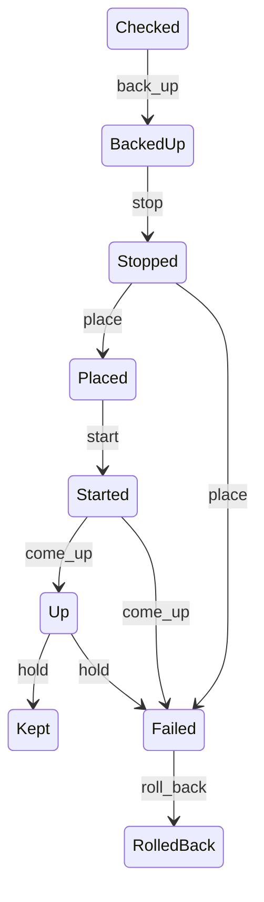
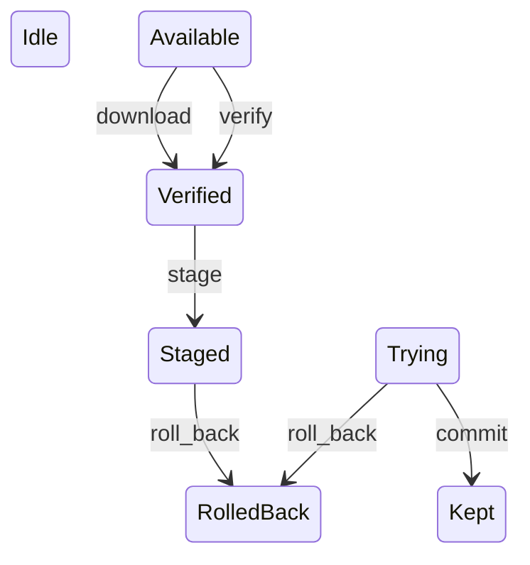
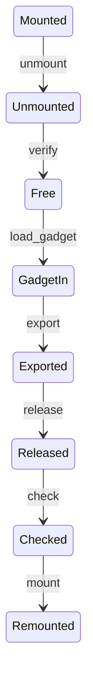
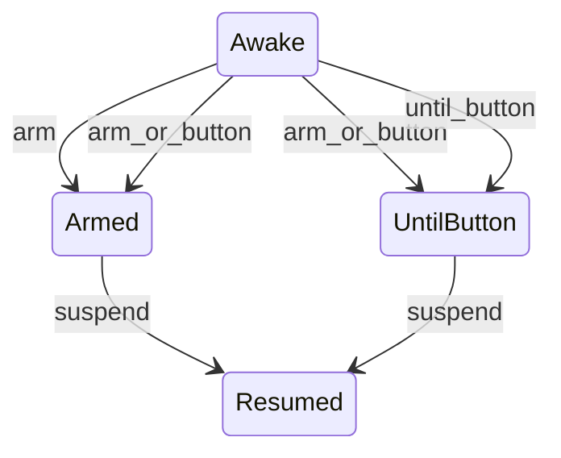
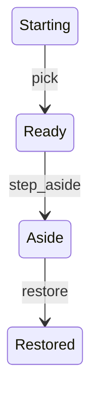
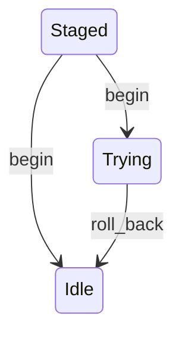

# State machines

kindil's step-by-step procedures are [statum](https://docs.rs/statum)
typestate machines: each step is a method of the state before it only, so
a step out of order doesn't compile. These graphs are what the macros
generate (statum's `introspection`), sorted; `cargo xtask state-machines`
writes them, and `cargo xtask check` fails while they are out of date.
Each line reads `State.method -> legal targets`: a method returning a
`Result` lists both of its machine targets. States a machine is rebuilt
into from files or from the device (`#[validators]`) are where it starts
again in a later run, not edges: the update trial's Staged and Trying, the
storage's Mounted, Released and Exported.

<!-- kindil: begin -->
## kindil install

src/install.rs: a release installs itself, and rolls back unless it comes up and holds.

`install::steps::Installing`: Checked, BackedUp, Stopped, Placed, Started, Up, Kept, Failed, RolledBack.



```text
BackedUp.stop -> Stopped
Checked.back_up -> BackedUp
Failed.roll_back -> RolledBack
Placed.start -> Started
Started.come_up -> Up | Failed
Stopped.place -> Placed | Failed
Up.hold -> Kept | Failed
```

## Over-the-air update

src/update.rs: kindil's side of an update; the launcher runs the trial (below).

`update::steps::Ota`: Idle, Available, Verified, Staged, Trying, Kept, RolledBack.



```text
Available.download -> Verified
Available.verify -> Verified
Staged.roll_back -> RolledBack
Trying.commit -> Kept
Trying.roll_back -> RolledBack
Verified.stage -> Staged
```

## USB drive mode

src/drive.rs: the user storage to a computer and back.

`drive::sequence::Storage`: Mounted, Unmounted, Free, GadgetIn, Exported, Released, Checked, Remounted.



```text
Checked.mount -> Remounted
Exported.release -> Released
Free.load_gadget -> GadgetIn
GadgetIn.export -> Exported
Mounted.unmount -> Unmounted
Released.check -> Checked
Unmounted.verify -> Free
```

## Suspend (naps and sleeps)

src/suspend.rs: every suspend; the caller has parked Wi-Fi.

`suspend::Suspend`: Awake, Armed, UntilButton, Resumed.



```text
Armed.suspend -> Resumed
Awake.arm -> Armed
Awake.arm_or_button -> Armed | UntilButton
Awake.until_button -> UntilButton
UntilButton.suspend -> Resumed
```

<!-- kindil: end -->
<!-- launcher: begin -->
## Launcher session

launcher/src/session.rs: Amazon's UI steps aside while kindil runs, and always comes back.

`session::lifecycle::Session`: Starting, Ready, Aside, Restored.



```text
Aside.restore -> Restored
Ready.step_aside -> Aside
Starting.pick -> Ready
```

## Update trial (launcher)

launcher/src/session.rs: a staged update's one trial run; kindil keeps it (above).

`session::steps::Trial`: Idle, Staged, Trying.



```text
Staged.begin -> Trying | Idle
Trying.roll_back -> Idle
```

<!-- launcher: end -->
